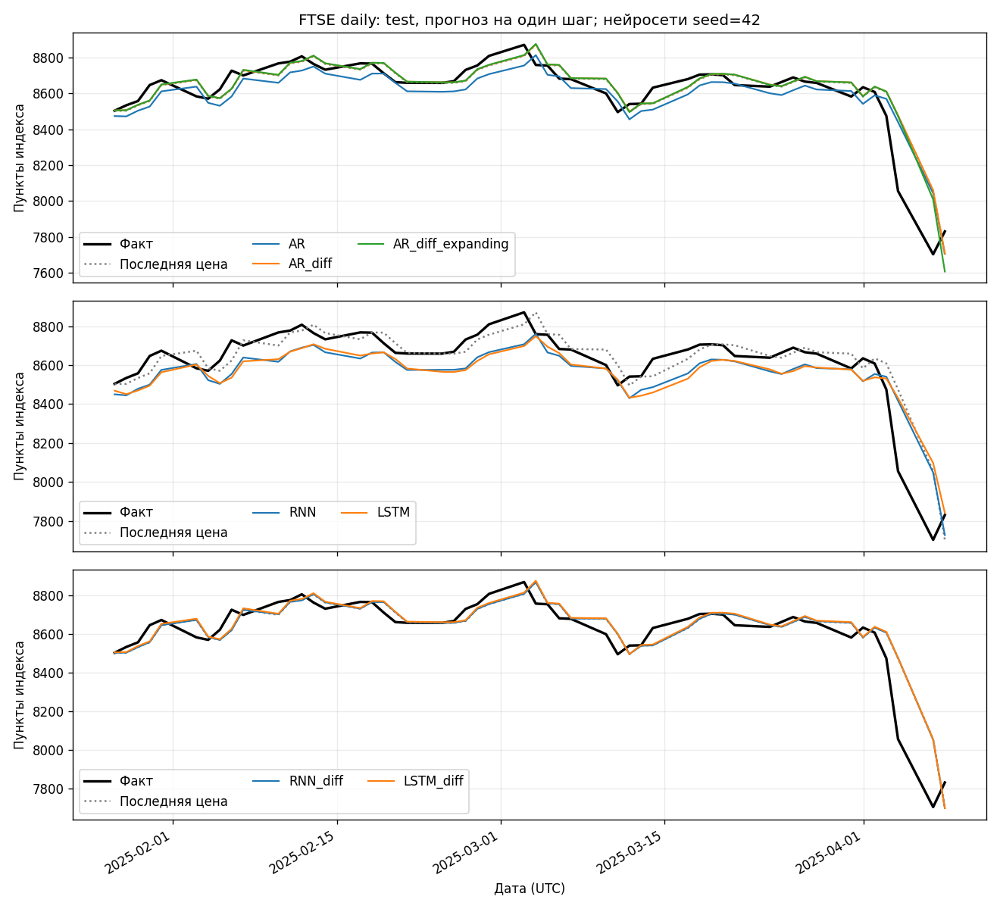
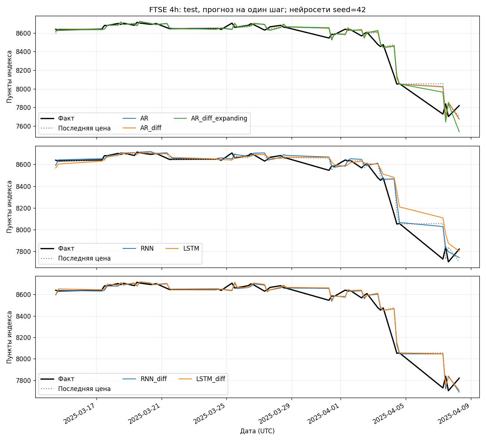
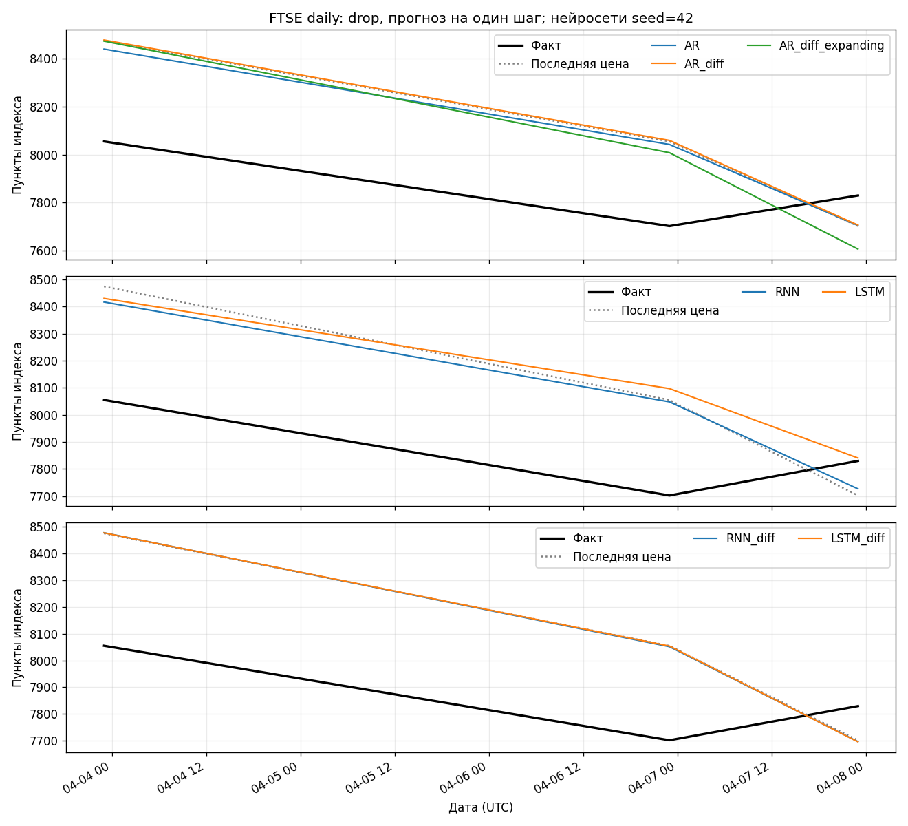
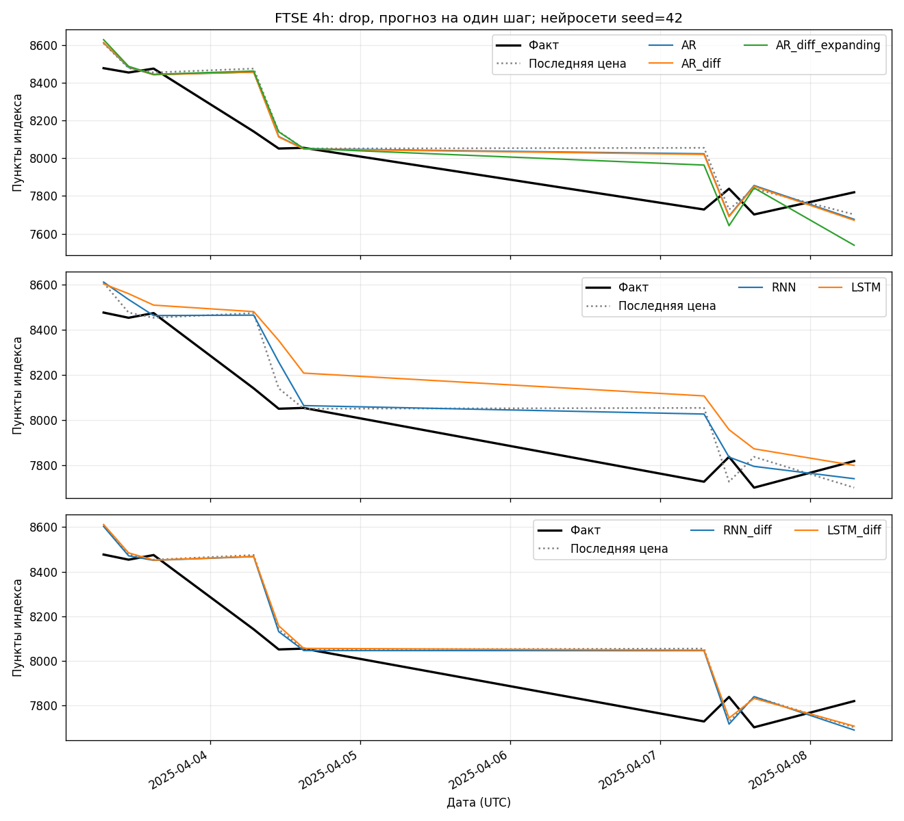

# Результаты эксперимента

## Постановка

Сравниваются прогнозы одного следующего наблюдения FTSE по его прошлым ценам закрытия.
Использованы оба файла, приложенные к семинару. Само новостное событие не является входом моделей.
Причинная связь падения с конкретным заявлением, упомянутая в условии, по CSV не устанавливается.

Первые 60% ряда используются для обучения при подборе, следующие 20% — для validation,
последние 20% — для итоговой оценки. Scaler сначала обучается на первых 60%, затем после выбора
настроек заново на первых 80%. Тестовые значения не участвуют ни в настройке scaler,
ни в выборе числа эпох или лага. Разности вычисляются только между соседними наблюдениями.

Все модели прогнозируют на одинаковых тестовых датах. Первое окно теста использует конец
обучающего ряда; первые 30 тестовых наблюдений не теряются. Для следующего шага уже известная
фактическая цена разрешена. Это одношаговая проверка со скользящим окном, а не многодневный
прогноз без новых наблюдений.

## Данные

| Ряд | Исходных строк | После очистки | Train / validation / test | Начало test (UTC) | Апрельских точек |
| --- | ---: | ---: | --- | --- | ---: |
| daily | 257 | 257 | 154 / 51 / 52 | 2025-01-27 00:00:00+00:00 | 3 |
| 4h | 257 | 255 | 153 / 51 / 51 | 2025-03-14 12:00:00+00:00 | 10 |

У четырёхчасового ряда удалены две строки без Close: 24 и 31 декабря 2024, 12:00 UTC.
Интерполяция не применялась. Пропуск Volume в последней дневной строке не мешает работе,
так как используется только Close. Исходные файлы сохранены без изменений, контрольные суммы
записаны в `results/run.json`.

Горизонт одного шага у рядов различен. Между сессиями и после исключённых пропусков шаг не равен
четырём календарным часам. Периоды тестирования также отличаются; поэтому численные ошибки
между частотами нельзя интерпретировать как прямую оценку преимущества одной частоты.

## Настройки

Окно нейросетей — 30 наблюдений, batch — 16, Adam: lr=0.001, weight_decay=0.0001.
Норма градиента ограничена 1. Максимум — 150 эпох, patience — 20.
Лучшая эпоха определяется по validation MSE, затем сеть переобучается с нуля на первых 80% ряда
ровно это число эпох. Число эпох выбирается отдельно для каждого из трёх заранее заданных seed:
42, 7, 123. Все запуски входят в средние; лучший seed не отбирается.

Базовая RNN имеет 50 скрытых нейронов и 1 слой, LSTM — 50 нейронов и 2 слоя.
Варианты на разностях имеют 16 нейронов и 1 слой; используются StandardScaler для разностей
и MinMaxScaler для уровней. Поэтому сравнение вариантов оценивает сразу несколько изменений,
а не чистый эффект дифференцирования. Дифференцирование не доказывает стационарность ряда.

AR проверяет лаги 1, 5, 10, 30 на validation. Для daily выбраны 5 (уровни) и 1 (разности),
для 4h — 10 в обоих случаях. Основные AR и AR_diff, как нейросети, фиксируют коэффициенты
после обучения. Отдельный AR_diff_expanding переобучается на расширенной истории на каждом шаге.
Это воспроизводит дополнительный блок семинара, но отличается по режиму обновления от остальных моделей.

## Численные результаты

MAE и RMSE приведены в пунктах индекса, MSE — в квадрате пунктов. Для нейросетей это средние
метрики трёх запусков, std — стандартное отклонение RMSE с ddof=0. Для AR и Naive один запуск
и std=0. Средний RMSE не равен корню среднего MSE при усреднении по seed.
Стандартное отклонение по трём инициализациям не является доверительным интервалом качества.

### daily, test: 52 наблюдений

| Модель | MAE | MSE | RMSE (среднее ± std) |
| --- | ---: | ---: | ---: |
| Naive | 56.20 | 8778.27 | 93.69 ± 0.00 |
| RNN_diff | 56.34 | 8798.33 | 93.79 ± 1.03 |
| AR_diff_expanding | 57.31 | 8837.31 | 94.01 ± 0.00 |
| AR_diff | 56.41 | 8887.58 | 94.27 ± 0.00 |
| LSTM_diff | 56.32 | 8909.32 | 94.39 ± 0.80 |
| AR | 71.45 | 9716.54 | 98.57 ± 0.00 |
| LSTM | 90.13 | 13859.58 | 117.61 ± 5.26 |
| RNN | 99.48 | 14219.00 | 119.12 ± 5.39 |

### daily, drop: 3 наблюдений

| Модель | MAE | MSE | RMSE (среднее ± std) |
| --- | ---: | ---: | ---: |
| RNN | 269.91 | 86374.31 | 293.83 ± 6.21 |
| AR | 283.61 | 93337.30 | 305.51 ± 0.00 |
| LSTM | 266.65 | 103345.91 | 321.25 ± 12.14 |
| RNN_diff | 301.01 | 105557.56 | 324.87 ± 3.95 |
| Naive | 300.10 | 105665.45 | 325.06 ± 0.00 |
| AR_diff_expanding | 316.09 | 106295.85 | 326.03 ± 0.00 |
| AR_diff | 301.32 | 107335.02 | 327.62 ± 0.00 |
| LSTM_diff | 300.85 | 107800.43 | 328.31 ± 3.97 |

### 4h, test: 51 наблюдений

| Модель | MAE | MSE | RMSE (среднее ± std) |
| --- | ---: | ---: | ---: |
| RNN | 43.46 | 6193.91 | 78.69 ± 1.50 |
| AR_diff | 45.82 | 6321.11 | 79.51 ± 0.00 |
| AR | 45.55 | 6326.43 | 79.54 ± 0.00 |
| LSTM_diff | 43.97 | 6427.49 | 80.17 ± 0.33 |
| Naive | 43.61 | 6518.56 | 80.74 ± 0.00 |
| RNN_diff | 45.14 | 6580.23 | 81.12 ± 0.69 |
| AR_diff_expanding | 48.20 | 7313.05 | 85.52 ± 0.00 |
| LSTM | 63.33 | 11226.54 | 105.24 ± 12.26 |

### 4h, drop: 10 наблюдений

| Модель | MAE | MSE | RMSE (среднее ± std) |
| --- | ---: | ---: | ---: |
| RNN | 124.11 | 26937.92 | 164.09 ± 3.46 |
| AR_diff | 131.67 | 27405.01 | 165.54 ± 0.00 |
| AR | 131.25 | 27492.78 | 165.81 ± 0.00 |
| LSTM_diff | 128.66 | 28278.86 | 168.16 ± 1.10 |
| RNN_diff | 130.14 | 28806.52 | 169.72 ± 1.62 |
| Naive | 129.30 | 28864.67 | 169.90 ± 0.00 |
| AR_diff_expanding | 147.86 | 32738.14 | 180.94 ± 0.00 |
| LSTM | 185.43 | 48931.65 | 220.37 ± 19.17 |

## Ответ на дополнительный вопрос

На полном дневном тесте RNN на разностях снижает средний RMSE с 119.12 до 93.79,
LSTM — с 117.61 до 94.39. При этом Naive даёт 93.69: улучшение нейросетей относительно
их базовых вариантов не означает преимущества перед последней известной ценой.

На четырёхчасовом тесте LSTM на разностях улучшает RMSE с 105.24 до 80.17.
Для RNN разности, напротив, ухудшают RMSE с 78.69 до 81.12. Лучший средний RMSE на этом
тесте у обычной RNN; Naive даёт 80.74. Различие небольшое и проверено на одном временном отрезке.

На выделенном апрельском отрезке лучший средний RMSE у обычной RNN: 293.83 для daily
и 164.09 для 4h. Но у дневного ряда всего 3 точки, у четырёхчасового — 10.
На daily различия по MAE дают иной порядок: LSTM немного лучше RNN. Победитель зависит от метрики.
Называть одну модель безусловно лучшей на основании таких маленьких выборок нельзя.

Графики показывают запаздывание: после сильного движения модели получают новую фактическую цену,
и следующий прогноз смещается вслед за ней. Малый RMSE на этом отрезке не доказывает, что модель
предвидела внешнее событие. В частности, модели на разностях часто близки к прогнозу нулевого изменения,
который после восстановления цены близок к Naive.

У некоторых моделей уровней лучшая эпоха близка к ограничению 150. Более длинное обучение могло бы
изменить результаты, но лимит после просмотра теста не менялся. Проверка большей сетки параметров
должна использовать новые validation-отрезки, а не этот уже просмотренный тест.

## Исправления исходного шаблона

- Scaler больше не обучается на тесте.
- AR и фактические значения сравниваются в одном масштабе.
- AR использует обновлённые лаги; история не остаётся неиспользуемым списком.
- Последняя цель не теряется при создании окон.
- Прогнозы и цели совпадают по датам, без выравнивания случайным обрезанием хвостов.
- Потери эпохи усредняются по всем примерам, а не берутся из последнего minibatch.
- Апрельский период выделен отдельно от марта.
- Обновление входного окна и переобучение параметров явно различаются.

## Проверка

Все кодовые ячейки `FTSE_completed.ipynb` последовательно выполнены в одном процессе IPython.
В блокноте сохранены реальные выводы и изображения. Проверки `unittest` контролируют границы окон,
отсутствие влияния будущих цен на более ранний прогноз AR, восстановление цены из разностей
и расчёт метрик. Прогнозы всех трёх seed сохранены отдельно, итоговые таблицы можно пересчитать.
Версии основных библиотек, seed, выбранные эпохи и лаги записаны в `results/run.json`.
Численная воспроизводимость на другой платформе или с другой версией PyTorch может немного отличаться.

## Графики

